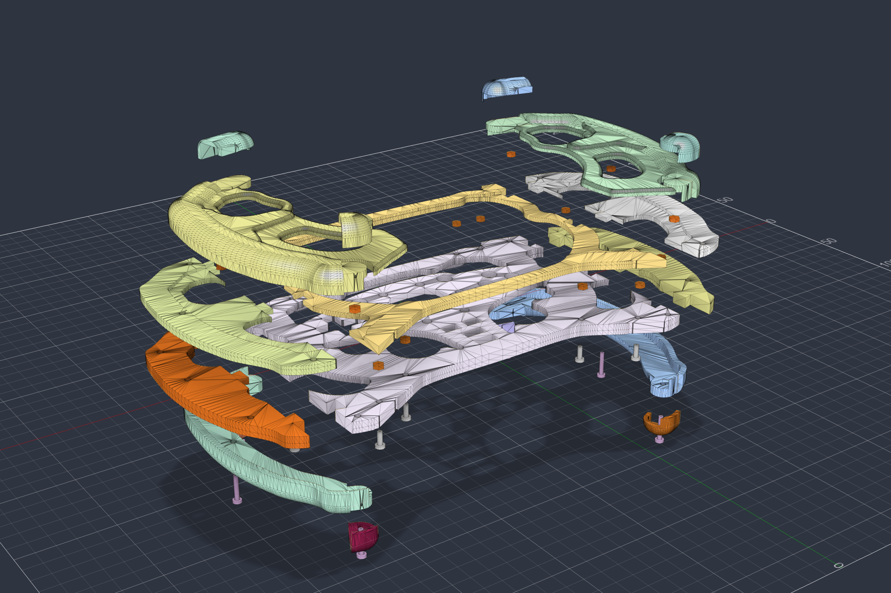
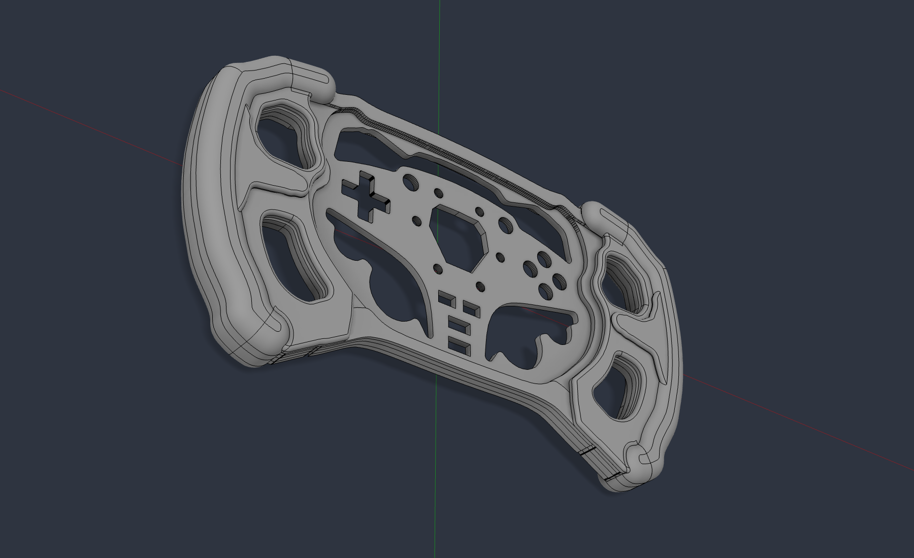
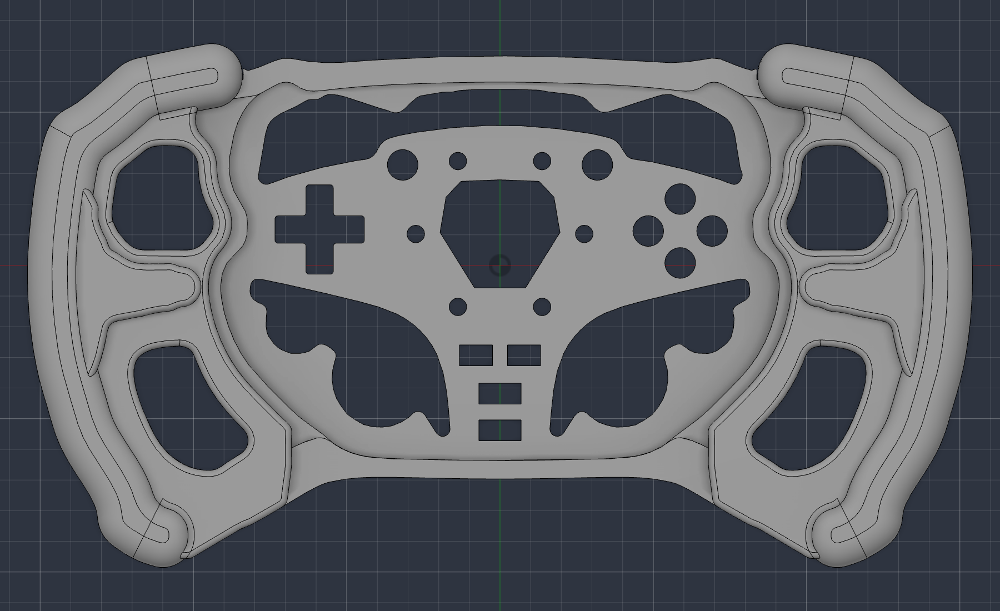
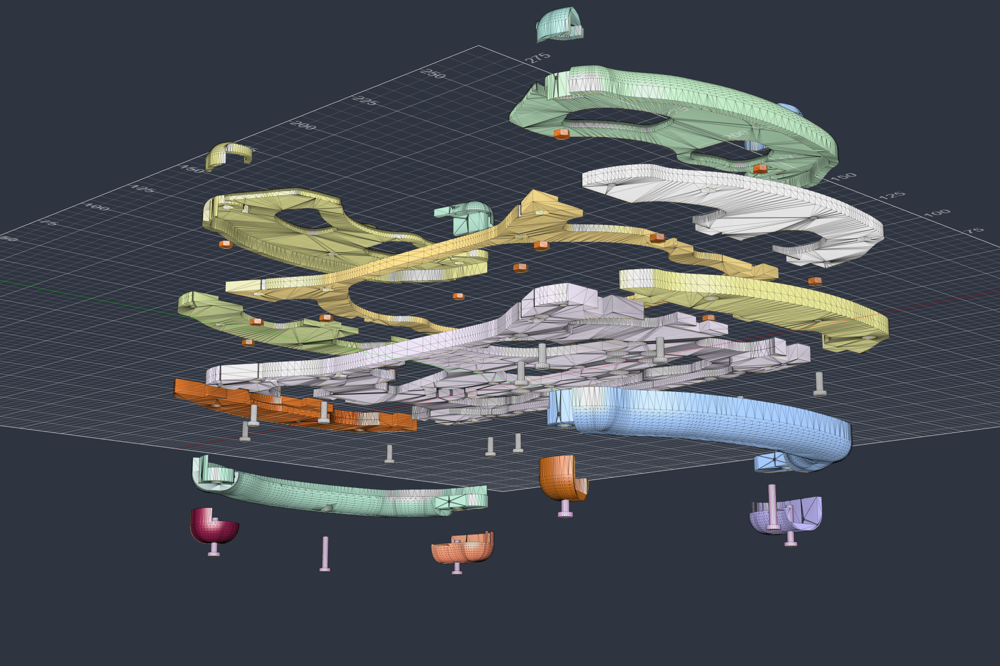
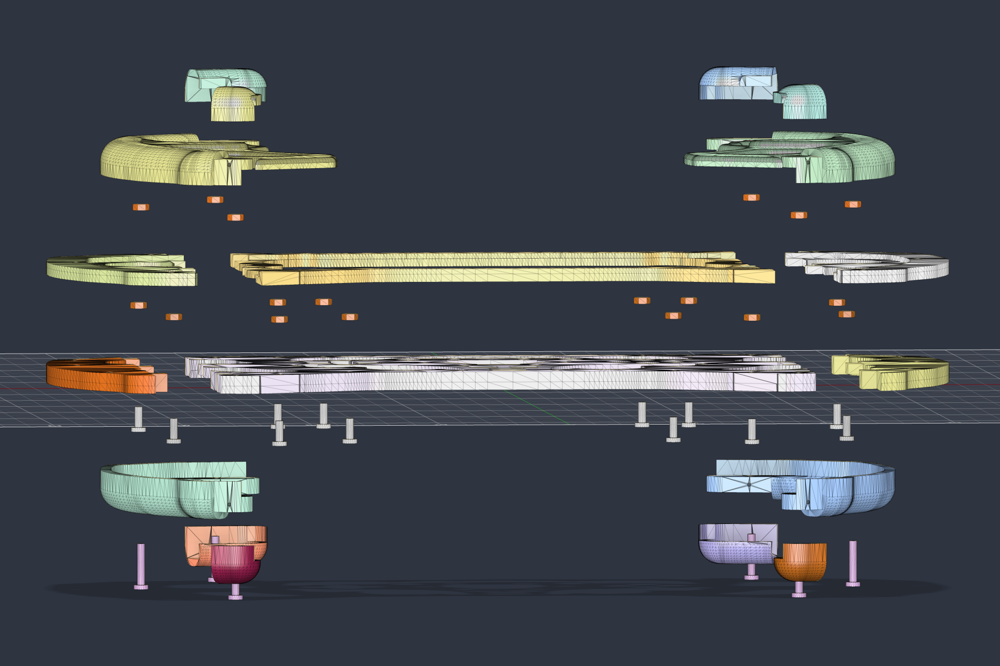
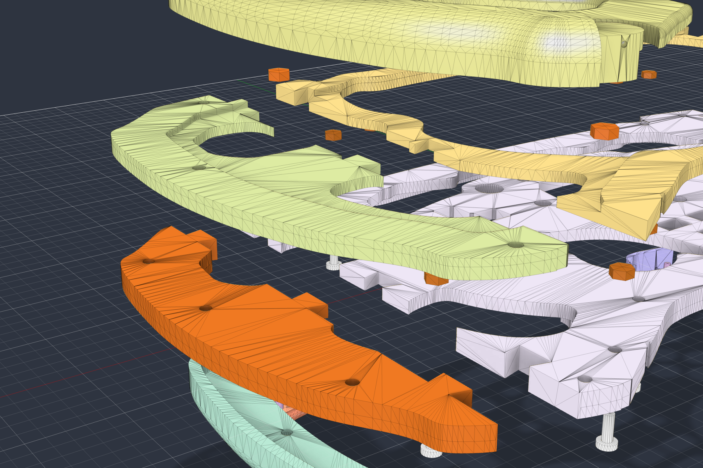
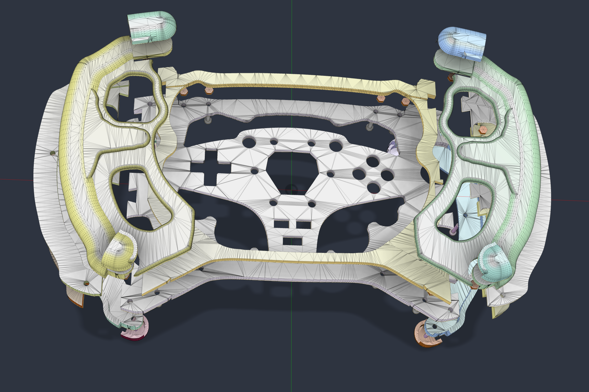
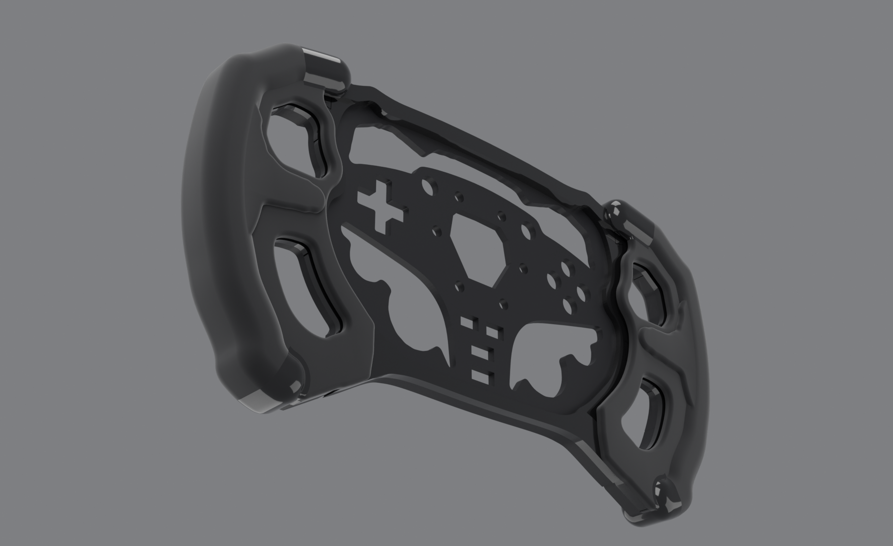
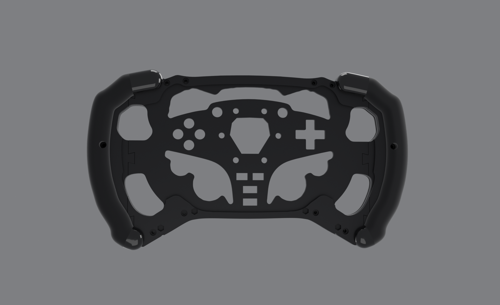
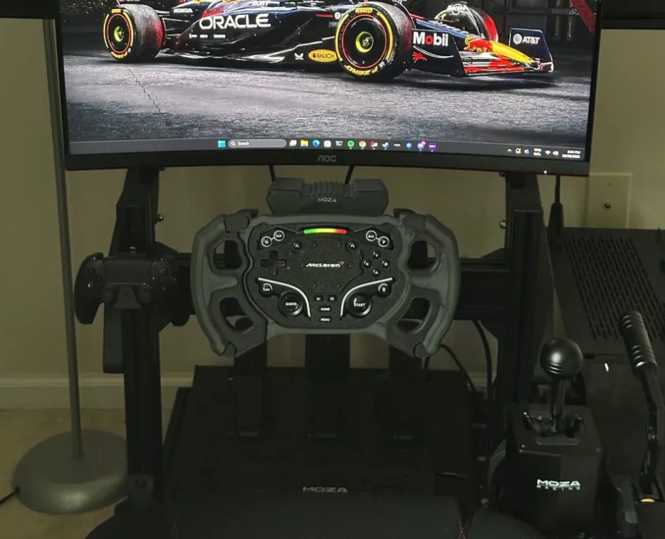

# F1 Custom Wheel (Moza ES)

A formula-style rim for the **Moza ES** wheel on an **R5** base, inspired by the Moza GS V2P look.
Designed in Fusion, printed in black PLA on a Bambu Lab P2S, and assembled with screws only (no glue).

> This repo is a build log. The CAD and print files aren't published yet. It works and looks good, but it isn't
> perfect yet (see [Known issues](#known-issues)).

## Specs

| | |
|---|---|
| Size | 308 × 171 mm, 28 mm deep at the grips |
| Fits | Moza ES centre unit (stock rim removed), on an R5 |
| Material | PLA, all black |
| Printer | Bambu Lab P2S (255 mm bed). Every part fits a 255 mm bed |
| Print | 18 parts on 6 beds, about 18.5 h and 380 g at 0.20 mm, 4 walls, 40% gyroid |
| Hardware | 12 × M3×8 + 6 × M3×16 button head screws, 18 × M3 nuts |
| Glue | none |

## The model

## How it goes together

| From below (screws) | Side on |
|---|---|
|  |  |

| Dovetail wings and nuts | From above |
|---|---|
|  |  |

The rim is 300 mm wide, which doesn't fit a 255 mm bed, so the faceplate is split. It's built as two plates on top of
each other: a **back plate** (7 mm) and a **front plate** (5 mm). Each plate is a centre piece plus two wings that
lock in with **dovetails**. The seams on the two plates are 16–18 mm apart, so each plate covers the other's joint,
like plywood. Both seams sit under the grips.

From the back of the wheel to the front:

1. **Back caps** clip onto the ends of the grips.
2. **Grip back halves**, held with 6 × M3×16 screws.
3. **Back plate** (centre + 2 wings), with 12 × M3×8 screw heads sunk into pockets.
4. **Front plate** (centre + 2 wings). The 12 nuts sit in hidden pockets inside it, so nothing shows on the front.
5. **Grip front halves**. The grip nuts sit inside, under the caps.
6. **Front caps** clip on over the grip screws, so no screw is visible on the front or the back.

Assembly is done face-down on a towel, so every nut stays in its pocket:
push the wings into the centres → nuts into the front plate → back plate on top → 12 screws → nuts in the grip
fronts → stack into the grips → grip backs → 6 screws → click the caps on → mount on the ES with the stock rim screws.

## Design notes

- **ES fit:** the button, D-pad and hub cutouts came from a test print that fit the ES centre exactly. The big openings
  around the pods were then fitted to the real ES outline with about 1 mm clearance. That took three short test
  prints (2 mm, 0.5 mm, then 1 mm with 2 mm at the top corners).
- **Grips:** E-shaped pillow grips with a round outer rail, a thumb spur between the finger windows, and separate
  clip-on end caps that hide the grip screws.
- **Thinking in layers:** the design started as four thin layers (back, plate, cover, frame), like a CNC'd
  aluminium wheel. Since everything is printed in one colour, the four layers became two plates for printing.

## Renders

How it looks finished, in black (Blender):

| | |
|---|---|
|  |  |

## Known issues

- **The grip slot has no clearance.** It's exactly as thick as the plate stack, and printed parts come out a bit thicker,
  so the grip halves leave a small gap at the split line. Fix: make the slot about 0.4 mm deeper, or sand the
  stack edges.
- **The front plate's lower seam** is a plain cut (no dovetail). The screws and the grip hold it.
- **PLA softens around 55 °C.** Don't leave it in a hot car. PETG would be the upgrade.
- More fixes are noted for a v2.

## On the rig

Printed and mounted on the R5:

## Credits

- The hub area started from the **CR1 ES formula mod** on MakerWorld.
- Inspired by the **Moza GS V2P**. Not affiliated with or endorsed by MOZA Racing. "Moza" is their trademark.
